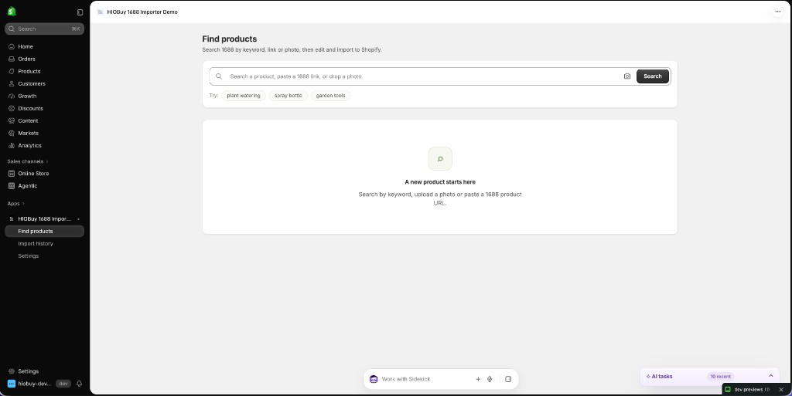
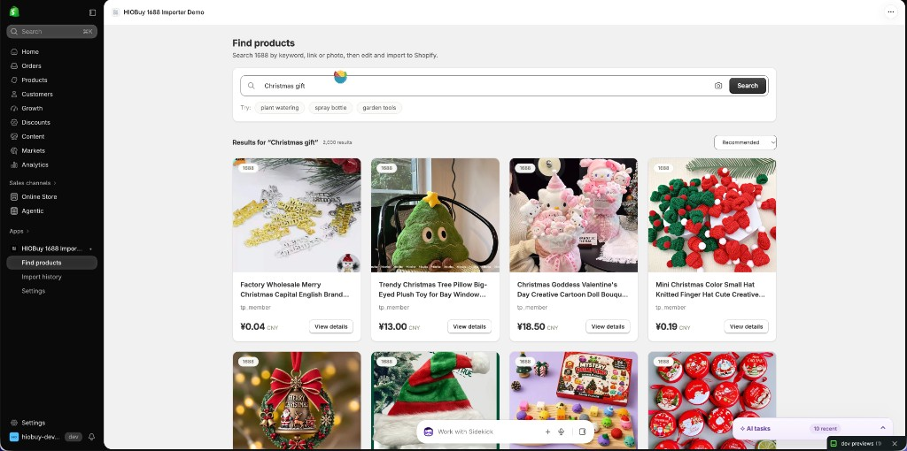
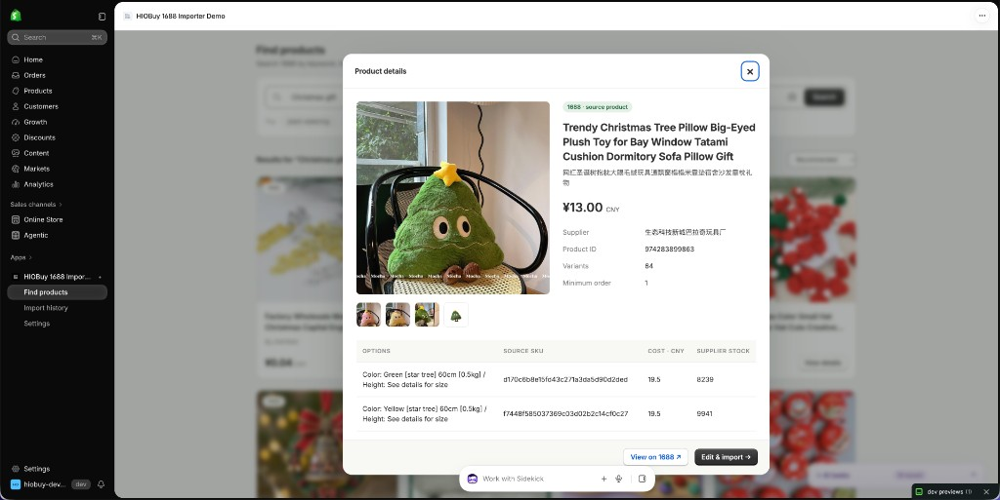
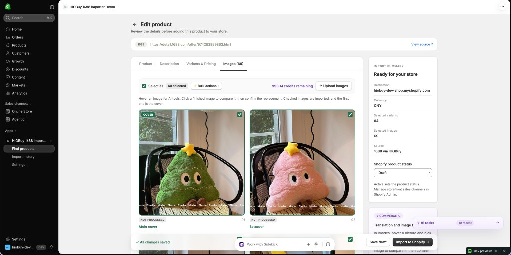

# HIOBuy 1688 → Shopify

An open-source Shopify Embedded App that lets developers search, edit, translate, and import real 1688 products into Shopify using HIOBuy APIs.

Build and run your own Shopify app, connect your HIOBuy API key, and customize the source code for your project.

Product search and import use HIOBuy's public product APIs. Title, description, attribute, and image tools use the separate public [Commerce AI V1](https://hiobuy.com/en/api-docs/commerce-ai) Credits API. AI Credits are billed separately from product API quota. This app does not grant Credits, bypass billing, or call private HIOBuy endpoints.

## Screenshots

These are from a development store using the public HIOBuy product API.

**Find products**



**Keyword search**



**Product details**



**Edit images before import**



## Features

- Search 1688 by keyword, uploaded image, or a validated `https://detail.1688.com/offer/<id>.html` URL. Results paginate, and product details load on demand.
- Edit Product, Description, Variants & Pricing, and Images, with database autosave and optimistic concurrency checks.
- Edit shared option names and each variant's values, exclude variants, and price from CNY cost with a manual exchange rate, multiplier, and rounding.
- Reorder images, choose a cover, upload images, and pick a variant image from thumbnails.
- **Import real 1688 products into Shopify.** Manual testing confirmed this path: a real product can be edited and created in Shopify as a Draft or Active product, including options, variants, and images. The import uses Admin GraphQL `2026-10`.
- Translate titles, descriptions, and attributes. Remove Chinese text from images, translate image text, or make a white background. Each AI task is estimated first and billed in AI Credits.
- Keep import history, inspect errors, safely retry an interrupted import, or reopen a snapshot as a new draft.

Import limits, inventory, and sales channels are listed under [Limitations](#limitations).

## Quick Start

You need Node.js 22.12 or newer (24 LTS is fine) and a Shopify account. A HIOBuy API key is required when you search or import real 1688 products. Do not run `npm init @shopify/app@latest` inside this folder. This repository is already the app. Shopify CLI creates your app the first time you start it.

**1. Install**

```sh
npm ci
cp .env.example .env
node -e "console.log(require('crypto').randomBytes(32).toString('base64'))"
```

Open `.env`. Paste the printed line after `ENCRYPTION_KEY=`. Leave `SHOPIFY_API_KEY`, `SHOPIFY_API_SECRET`, and `SHOPIFY_APP_URL` empty. Leave `client_id` in `shopify.app.toml` empty. A placeholder in either file makes the CLI look up an app that does not exist.

**2. Start**

```sh
npm run dev
```

**3. Answer the prompts**

1. A browser opens so you can log in to Shopify. Approve it. You are already logged in if the terminal says `Logged in.`
2. **Create this project as a new app on Shopify?** Choose **Yes, create it as a new app**.
3. If you have no development store, create one when asked, finish that page, then return to the terminal and confirm.
4. **Have Shopify override your app URLs?** Choose **Yes**.
5. Press `p`, or open the Preview URL printed in the terminal. Use that Shopify Admin link. Do not open `localhost` yourself.

The CLI writes the Client ID into `shopify.app.toml` and the key, secret, and tunnel URL into `.env`. Do not commit those values.

**4. Connect HIOBuy**

Register as a developer and create an API key at [developers.hiobuy.com](https://developers.hiobuy.com/). The public API reference is at [hiobuy.com/api-docs](https://hiobuy.com/api-docs).

In the app, open **Settings**. Paste a HIOBuy production API key (`hio_live_…`) and choose **Save and test connection**. During a trial, that key uses the same public production product API. The currency follows your Shopify store. If the store does not sell in CNY, set the exchange rate before the first import.

This demo still recognizes an older `hio_test_…` key shape. Drafts created with that key are labeled in the app, and Active import is blocked for them. That label is a local safeguard. It is not a current HIOBuy Sandbox API. New development should use a production key. Automated tests in this repository use local synthetic fixtures, which are also not HIOBuy product data.

If the terminal says `no app was found for the provided apiKey`, `shopify.app.toml` still has a fake `client_id`, or `.env` still has a fake `SHOPIFY_API_KEY`. Clear both, then run `npm run dev` again.

If the app frame is blank, open the `trycloudflare.com` URL directly. An empty `404` means `~/.cloudflared/config.yml` is overriding the tunnel. Rename that file and restart `npm run dev`. More fixes are in [docs/SETUP.md](docs/SETUP.md).

Full configuration, Docker, and troubleshooting: **[docs/SETUP.md](docs/SETUP.md)**.

## First Import

1. Search, upload a product photo, or paste `https://detail.1688.com/offer/<id>.html`.
2. Open a product, inspect the supplier fields and SKUs, then select **Edit & import**.
3. Edit all four tabs. Check prices and selected variants. Missing source prices must be entered manually. Supplier stock is informational.
4. Select **Draft** first, then **Import to Shopify** and confirm the store write.
5. If Shopify is still processing media, wait or use **Finish import** / **Safe retry**. Retry resumes the same import snapshot and product identifier.
6. Open the Shopify product and check options, prices, SKU pictures, cover and order, description, and status.

**Re-edit** creates a new draft. Importing that draft creates a separate product. Safe retry resumes the original import. The UI explains this before a new import.

## AI Features

Commerce AI is optional and uses a prepaid HIOBuy AI account discovered from the same API key. Credits are not product API quota, and this app cannot buy or grant them. Top up in HIOBuy Developer Center → AI Enhancement.

| Action | Billing |
| --- | --- |
| Translate title, description, or attributes | Text Credits. Preview the result, then apply it. |
| Remove Chinese text, translate image text, or white background | Image Credits, typically one image at a time. Confirm before the draft image is replaced. |

The server estimates the cost first. If the balance is too low, no task is created. Image results are downloaded only from `https://api.hiobuy.com/v1/ai/assets/…`. Local uploads are not sent. SEO generation and general image optimization are not part of public Commerce AI V1 and are not called.

Provider limits still apply. A second image task started while another is running can be rate limited, and a finished task can fail if HIOBuy does not serve the result file. Those cases are reported in the editor. They are not a substitute for product import, which does not require AI.

## Docker Deployment

```sh
docker compose up --build -d
```

Configure `.env` first. Compose binds to `127.0.0.1:3000`. Put an HTTPS reverse proxy in front and set the public URL and OAuth callback. `/data` is a persistent named SQLite volume. Back up the volume and encryption key together. Run one application replica for this SQLite demo. See [deployment instructions](docs/SETUP.md#docker-deployment).

A container build and restart were not part of the checks recorded below.

## Development and Verification

```sh
npm run typecheck
npm test
npm run build
npm run check:security
npm run check:licenses
npm audit --omit=dev --registry=https://registry.npmjs.org
```

Optional local UI checks use synthetic fixtures and do not call HIOBuy or Shopify:

```sh
npx playwright install chromium
npm run test:visual
```

The visual harness is not mounted on production routes. It labels its data as synthetic.

**What was confirmed manually:** importing a real 1688 product into Shopify works. That check used a configured Shopify app, a HIOBuy production key, and a development store. It is not an automated test, and it does not cover every store, media failure, or quota case.

**What automation covers:** typecheck, unit and integration tests, the production build, a secret-pattern scan, and the dependency license inventory. Those tests use stand-in HTTP responses and synthetic fixtures. They do not prove a live account.

Details and the latest command results are in [docs/VERIFICATION.md](docs/VERIFICATION.md).

## Documentation

- [HIOBuy API docs](https://hiobuy.com/api-docs)
- [Register and create a HIOBuy API key](https://developers.hiobuy.com/)
- [Setup and deployment](docs/SETUP.md)
- [Architecture and security boundaries](docs/ARCHITECTURE.md)
- [Public API integration and Shopify mapping](docs/API-INTEGRATION.md)
- [Implemented behavior, earlier simulations, and limitations](docs/TODO.md)
- [Original inspection plan](docs/PLAN.md)
- [Verification](docs/VERIFICATION.md)
- [Third-party notices](THIRD_PARTY_NOTICES.md)

## Limitations

- One import handles at most **100 selected variants, 3 options, and 50 images**. Larger catalogs need a smaller selection or a future bulk importer.
- Supplier stock is informational. Shopify inventory stays untracked. There is no fulfillment, tax, shipping, or procurement sync.
- Active sets the product status. It does not publish the product to a sales channel. Choose channels in Shopify Admin.
- Very slow Shopify media processing can leave the import in **Finish import** / **Safe retry**. A lost `fileCreate` response can leave an unused Shopify file. This app does not delete those files.
- Draft history shows the 20 most recently edited unfinished drafts. There is no separate draft-deletion screen.
- One SQLite process is supported. Do not run several replicas against one database file.
- `hio_test_…` drafts stay labeled and cannot be imported as Active. Use `hio_live_…` for real catalog data.

## Disclaimer

This is a standalone Shopify Embedded App and an official HIOBuy open-source example. It is not the commercial HIOBuy 1688 AI Importer, and it does not include that product's private services, billing, or customer data.

You need your own Shopify app and your own HIOBuy API key. Marketplace product content is fetched with that key and is not stored in this repository. You are responsible for the rights to use that content and for AI Credit charges.

Shopify and HIOBuy names identify the services this app calls. The MIT license does not grant trademark rights.

## License

MIT. See [LICENSE](LICENSE). Authentication scaffolding is derived from Shopify's React Router template; keep that copyright notice. Other dependency licenses are recorded in [THIRD_PARTY_NOTICES.md](THIRD_PARTY_NOTICES.md) and [docs/DEPENDENCY-LICENSES.json](docs/DEPENDENCY-LICENSES.json).
