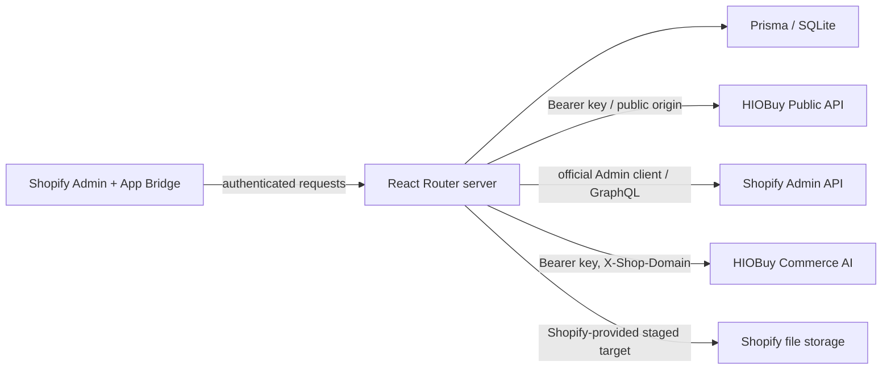

# Architecture

## Runtime

React Router 7 + TypeScript + React provide server-rendered routes and the four-tab editor. Shopify's official React Router package authenticates admin requests, performs the supported embedded token flow and manages expiring offline tokens through a Prisma session adapter. App Bridge is loaded by the official AppProvider. App navigation is registered with Shopify; the workspace uses independently authored responsive CSS following the supplied prototype's flow.

Node 24 and SQLite/Prisma make the demo runnable without company Cloudflare bindings. The official Shopify MIT template informs authentication/SSR scaffolding; commercial implementation files were not reused. One Node replica is the supported Docker topology.

## Storage

| Model        | Contents                                                                                                                                       |
| ------------ | ---------------------------------------------------------------------------------------------------------------------------------------------- |
| Session      | Official Shopify session fields; access and refresh tokens encrypted at rest                                                                   |
| ShopSettings | Encrypted HIOBuy key, cached Commerce AI account (discovered from the key), environment label and pricing defaults |
| Draft        | Shop ownership, source ID/URL, environment provenance, normalized source snapshot, complete editor JSON and version                            |
| Asset        | Shop/draft-owned uploaded image bytes and validated MIME metadata                                                                              |
| ImportRecord | One immutable snapshot per draft, deterministic product handle, locks, attempts, cached Shopify file IDs, product ID, status/errors/timestamps |
| AiJob        | Capability, idempotency key, remote job id, saved request, status and result |

Deleting a draft cascades its assets/jobs/imports. The authenticated uninstall webhook removes app sessions, settings and drafts for that shop. Shopify products/files already created by the app remain in the merchant's store. No customer/order data is requested.

## Request boundaries

Every app loader, resource route and action calls `authenticate.admin`. Webhooks use `authenticate.webhook` HMAC validation. Public routes are login/OAuth and health only. Shop identity always comes from the verified Shopify session; browser input cannot select another shop. The standard Shopify error/response boundary preserves authentication headers and embedded escape responses.

Mutating app APIs require same-origin POST. JSON and multipart bodies are byte-bounded before parsing. Uploaded images are limited to 4 MB and JPEG/PNG/WebP MIME and magic signatures. Images are stored under an authenticated resource; browser previews fetch them with App Bridge-authenticated fetch and use temporary object URLs. There are no public asset URLs or filesystem paths accepted from a browser.

HIOBuy product calls use a fixed HTTPS origin and the documented product paths. Commerce AI adds the documented `/v1/ai/…` paths on the same origin, with `X-Shop-Domain` and `X-Idempotency-Key` where the contract requires them. Product URLs are parsed for an ID, never fetched; only standard HTTPS 1688 listing URLs are accepted. Remote supplier media used for publishing is limited to known HTTPS CDN suffixes. AI result bytes are downloaded only from `https://api.hiobuy.com/v1/ai/assets/…`, with redirects rejected. The app server does not retrieve arbitrary image hosts. Shopify fetches approved remote images; local bytes go to a server-validated staged target returned by authenticated Shopify GraphQL. Network redirects on HIOBuy and staged-upload requests are rejected.

## Credentials

`ENCRYPTION_KEY` is a stable, randomly generated 256-bit server secret. AES-256-GCM uses a fresh 96-bit nonce for each encryption. Both HIOBuy keys and Shopify access/refresh tokens are encrypted before database storage and decrypted only on the server. Settings loaders return an explicit safe projection. Browser storage is not used for credentials or editor state. Authenticated responses use no-store caching. Logs do not print full upstream bodies or credentials.

The database itself is not wholly encrypted: normalized product content and required session identity fields remain normal database records. Protect host storage/backups. This is an independently hosted app, not a managed multi-tenant service.

## Editor persistence

The entire editor model is owned by the parent workbench; changing panels cannot discard edits. Autosave debounces for 900 ms and serializes in-flight saves. Optimistic version comparison rejects competing tabs. Navigation and browser-close guards warn if edits have not been saved. Import waits for pending saves. Invalid fields produce an error while local edits remain visible; only valid data is saved. Import snapshots cannot be edited in place.

Sanitization runs in the description editor before HTML is kept, and again on the server before storing and publishing. Script, style, and iframe tags are removed. Description images are given `referrerpolicy="no-referrer"` so supplier CDNs that check the referrer can load. Edited attributes are escaped and appended to the Shopify description as a Product details table. Original source descriptions and attributes remain separately inspectable.

## Publishing and recovery

1. Authenticate, check granted Shopify scopes and store currency, and validate the editor mapping.
2. Transactionally freeze the current version as one ImportRecord per draft. Fresh import requires the current saved draft version.
3. Acquire an atomic lock with a unique token; fresh running locks reject duplicate requests. Locks are refreshed between network steps and become recoverable after 10 minutes.
4. Stage local uploads if necessary; create Shopify image files and persist each returned file ID. Poll Shopify media status for up to 20 seconds. Still PROCESSING becomes NEEDS_RETRY, which the editor retries automatically; FAILED remains an explicit failure.
5. Resolve the deterministic product handle and reuse existing variant IDs matched by option combinations when recovering a partial attempt.
6. Execute synchronous `productSet` by existing product ID or deterministic handle, with full options, variants and ordered file associations. This is an upsert, not an unprotected create.
7. Persist returned product ID and status under the acquired lock token. On transport uncertainty, retain the same snapshot/identifier for safe retry.

Safe retry replays the import snapshot; it does not change source prices or current settings. A deliberate Re-edit duplicates a draft and any uploaded assets into a new draft, so a subsequent import is explicitly a new product. The demo does not claim a distributed transaction between SQLite and Shopify. If a merchant manually changes a product handle during an unconfirmed import, identifier recovery requires operator review; keep the app-generated handle unchanged until success.

## Commerce AI

Public V1 operations are title, description and attribute translation, image text removal, image translation and white background. The adapter estimates Credits, then submits one persisted idempotency key. Polling uses the returned job id and does not create a second paid task when the provider outcome is unknown. Image results are stored as draft assets only after a same-origin HIOBuy asset download. Applying a result is explicit. SEO generation and general image optimization are rejected because they are outside the public contract. Older simulated rows can still be displayed; new tasks are not simulated.
